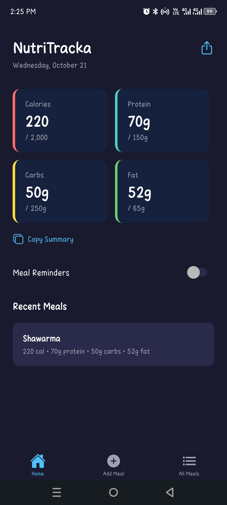
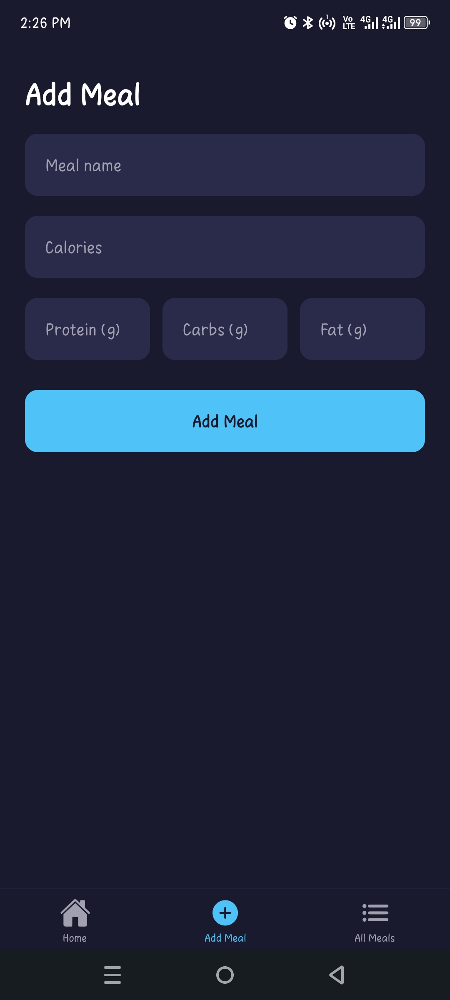
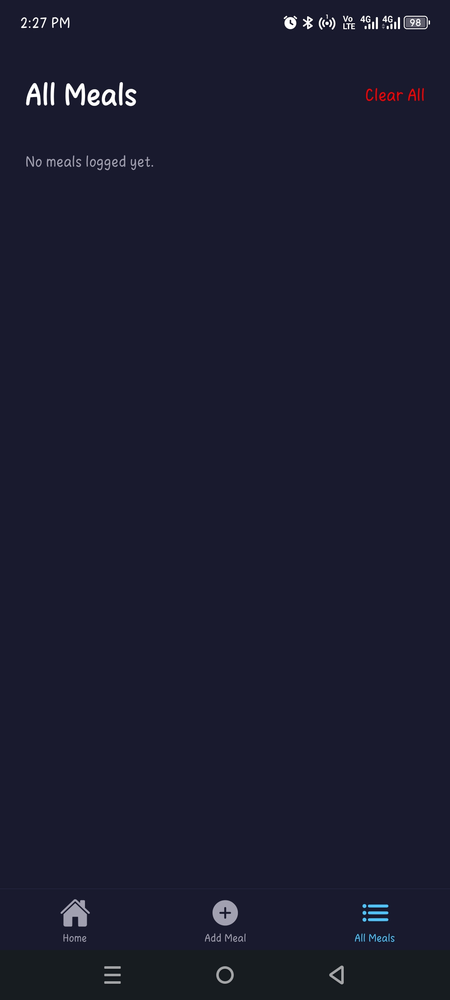
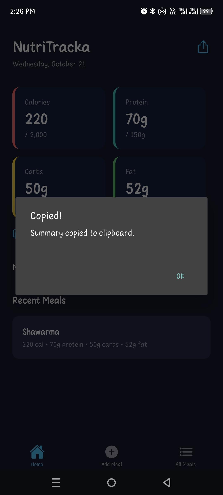
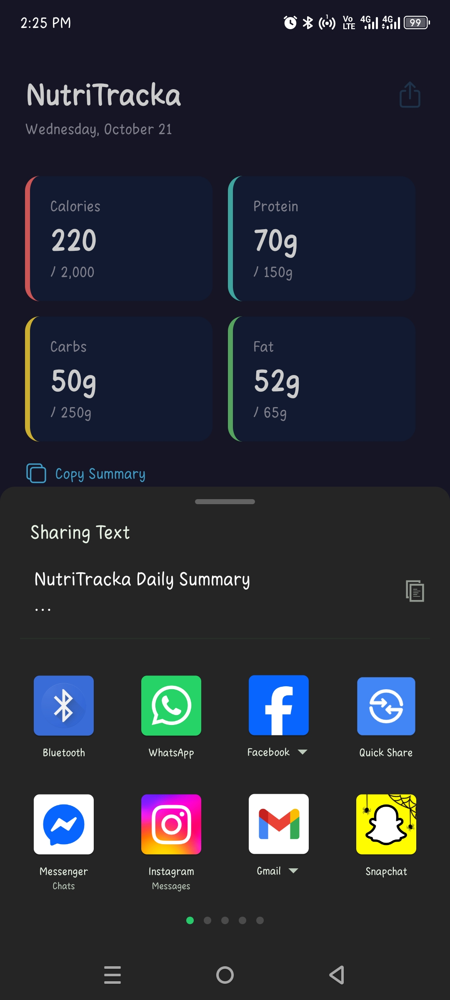
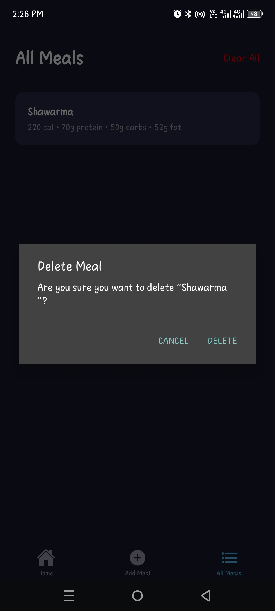

# NutriTracka

A mobile nutrition tracker built with React Native and Expo. Log your meals, see your daily calories, protein, carbs and fat at a glance, and get gentle reminders to log lunch and dinner.

  
  

## Features

- **Daily dashboard** showing calories, protein, carbs and fat against daily targets
- **Add meals** with a validated form for name, calories and macronutrients
- **Meal history** with long-press to delete, including a confirmation prompt and haptic feedback
- **Share and copy** a daily nutrition summary in one tap
- **Meal reminders** delivered as daily local notifications at lunch and dinner time
- **On-device storage**, so your meals persist between sessions without an account
- **Tab navigation** between Home, Add Meal and All Meals using Expo Router

## Tech Stack

- [React Native](https://reactnative.dev/) with [Expo](https://expo.dev/) (SDK 57)
- [TypeScript](https://www.typescriptlang.org/)
- [Expo Router](https://docs.expo.dev/router/introduction/) for file-based navigation
- [expo-notifications](https://docs.expo.dev/versions/latest/sdk/notifications/) for local reminders
- [expo-haptics](https://docs.expo.dev/versions/latest/sdk/haptics/) and [expo-clipboard](https://docs.expo.dev/versions/latest/sdk/clipboard/)
- [@expo/vector-icons](https://docs.expo.dev/guides/icons/) (Ionicons)
- [EAS Build](https://docs.expo.dev/build/introduction/) for development and installable Android builds

## Download

Android APK: [Download the latest build](https://expo.dev/accounts/chiomasarah/projects/nutritracka/builds/8e9bb0f7-f118-4375-807a-f21d30173a7d)

## Getting Started

### Prerequisites

- [Node.js](https://nodejs.org/) (LTS)
- An Android emulator via [Android Studio](https://developer.android.com/studio), or a physical Android device
- An [Expo account](https://expo.dev/signup) and the EAS CLI: `npm install -g eas-cli`

### Installation

```bash
git clone https://github.com/ChiomaSarah/nutritracka.git
cd nutritracka
npm install
```

### Running the app

NutriTracka uses `expo-notifications`, which is not fully supported in Expo Go, so it runs in a **development build** instead.

1. Create and install a development build (only needed once, or after adding native packages):

   ```bash
   eas build:dev
   ```

2. Start the development server:

   ```bash
   npx expo start
   ```

3. Press `a` to open the app on a running Android emulator, or open the NutriTracka development build on your device and connect to the server.

## Building an APK

To produce a standalone APK you can install or share:

```bash
eas build --platform android --profile preview
```

When the build finishes, EAS provides a download link and QR code.

## Project Structure

```
src/
├── app/                    # Screens (Expo Router)
│   ├── _layout.tsx         # Root stack layout
│   └── (tabs)/
│       ├── _layout.tsx     # Tab navigator
│       ├── index.tsx       # Home dashboard
│       ├── add-meal.tsx    # Add meal form
│       └── meals.tsx       # All meals
├── components/             # Reusable UI components
├── storage/                # Meal persistence
├── styles/                 # Shared colors and styles
└── utils/                  # Notification helpers
```

## Scripts

| Command             | Description                          |
| ------------------- | ------------------------------------ |
| `npm run start`     | Start the development server         |
| `npm run android`   | Start the server and open on Android |
| `npm run build:dev` | Create or reuse a development build  |
| `npm run lint`      | Run the linter                       |

## Author

**Sarah Chioma Osuji**
